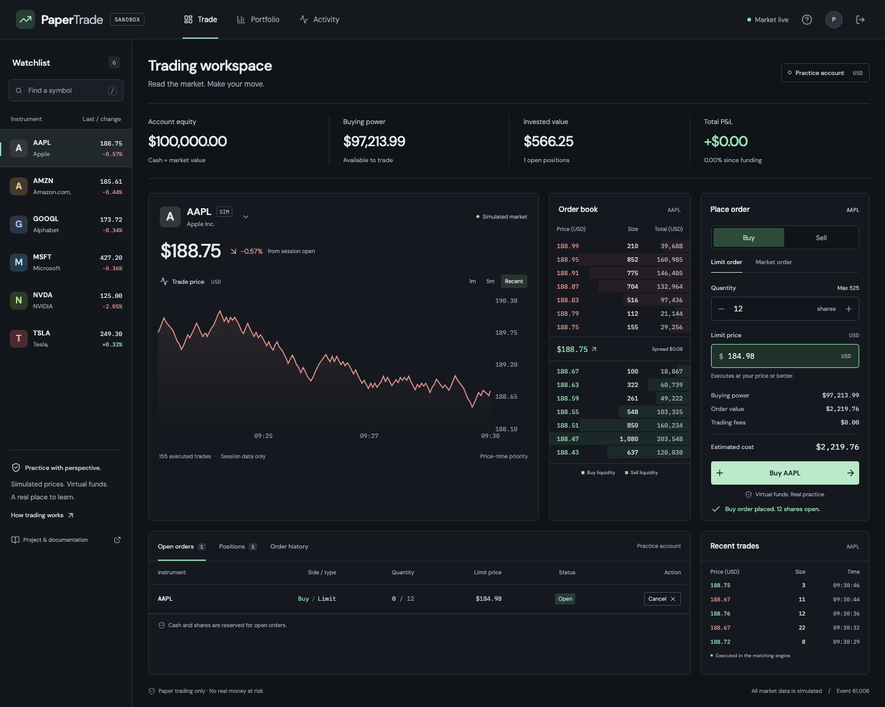
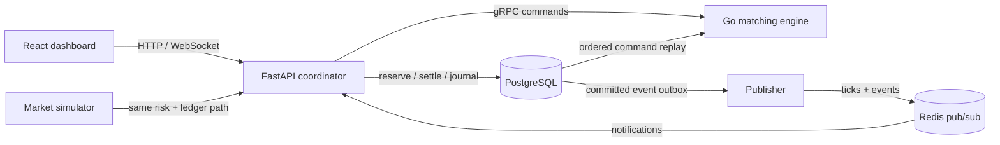

# PaperTrade

[](https://github.com/Sujendra-23/PaperTrade/actions/workflows/ci.yml)

A working paper exchange, from matching to settlement. Place orders against a simulated market, inspect the live order book, and follow cash, positions, and P&L through a transactional ledger.

**All funds and prices are simulated.** No broker integration or real-money trading.



## Run locally

Install Docker with Compose, then:

```sh
git clone https://github.com/Sujendra-23/PaperTrade.git
cd PaperTrade
docker compose up --build -d --wait
```

Open **[localhost:5173](http://localhost:5173)**. Start a guest practice session, or create a username and password to return to the same portfolio. Each account starts with **$100,000 in virtual cash**. Guest and registered users have separate portfolios and private orders. The simulator supplies liquidity for AAPL, AMZN, GOOGL, MSFT, NVDA, and TSLA.

API reference: [localhost:8000/docs](http://localhost:8000/docs). `docker compose down` stops the stack and preserves the PostgreSQL volume. Docker ports bind to localhost.

## What works

- **Go order book:** limit orders, price-protected IOC market orders, partial fills, cancellation, maker-price execution, price-time priority, per-symbol books, and self-trade prevention.
- **gRPC:** `PlaceOrder`, `CancelOrder`, `GetBook`, `StreamTrades`, health, and internal recovery/reset RPCs. Commands are idempotent in the engine and durable in PostgreSQL.
- **Accounting:** integer-cent cash, whole-share positions, open-order reservations, per-trade balanced USD and inventory journals, average-cost basis, realized and unrealized P&L, and reconciliation against materialized balances.
- **Risk:** order-size limits, position limits including open buys, buying power, available shares, and a 5% band around the last trade. No leverage or shorting.
- **Live data:** random-walk bot liquidity uses the same coordinator and settlement path. Committed events and ticks flow through Redis pub/sub; authenticated WebSockets deliver coherent account and market snapshots.
- **Dashboard:** interactive depth-to-ticket prices, buy/sell and limit/market tickets, cancellation, portfolio/equity charts, order history, activity, risk feedback, and automatic stream reconnects.
- **Accounts:** guest sessions, registration, sign-in/out, scrypt password hashes, expiring revocable server sessions, HttpOnly/SameSite cookies, origin checks, and account-scoped reads and writes.

## Architecture



The API is a **single writer per database**, enforced by a PostgreSQL session advisory lock. It serializes commands through reservation, matching, and settlement. This deliberate boundary makes correctness and recovery understandable; it does not claim horizontally scaled order ingestion.

1. Authenticate the account and check its idempotency key and request fingerprint.
2. Lock its balances, check risk, reserve cash or shares, and commit a durable `PENDING` command.
3. Submit that command to the Go engine.
4. In one database transaction, apply every fill to both accounts, update positions and reservations, write journals and events, and mark the command `DONE`.
5. Publish committed data. Clients fetch an initial snapshot and receive fresh snapshots through WebSockets.

A database and an in-memory process cannot share a normal SQL transaction. The durable command log closes that gap: at API startup, engine restart, or an uncertain RPC/settlement result, the coordinator resets and replays commands in sequence, then settles pending intents exactly once in PostgreSQL. Tests inject failures after matching, including after a fill, to verify this path.

See [design decisions and boundaries](docs/architecture.md) for the journal convention, recovery behavior, and tradeoffs.

## Measured results

Measured on **October 15, 2026**, Apple M4, 24 GiB memory, macOS 27.0, Go 1.27.0.

| Check | Observed result |
| --- | ---: |
| Random orders submitted to the in-process engine | 1,000,000 |
| Throughput | 2,203,655 orders/sec |
| p50 `Engine.Place` latency | 0.292 µs |
| p99 `Engine.Place` latency | 1.541 µs |
| Go tests with race detection | 12 top-level tests + 7 matching subtests passed |
| Python integration tests | 35 passed |
| One-account concurrent order test | 100 submitted; 55 accepted; 45 risk-rejected; no overspend |

**The throughput and latency figures measure the in-process order book, not gRPC or end-to-end API throughput.** Input generation is outside the timer; allocation, matching, locking, and per-order timing are inside. These are one local run, with no performance guarantee. Raw output, methodology, and reproduction commands are in [docs/benchmarks.md](docs/benchmarks.md). Browser smoke results are in [docs/browser-smoke.json](docs/browser-smoke.json).

## Tests and development

Local tools: Go 1.25+, Python 3.13, uv, Node 24+, npm, and Docker Compose. Dependency locks and generated protobuf clients are committed.

```sh
# Race-detected matching and gRPC tests
cd engine && go vet ./... && go test -race -count=1 ./...

# From the repository root: isolated test database and test engine
./scripts/test-api.sh -v

# Frontend typecheck, lint, and production build
cd web && npm ci && npm run check && npm run build

# Browser smoke test against the running Compose stack
npx playwright install chromium
node scripts/smoke.mjs

# From the root: one million orders; emits JSON
./bench/run.sh
```

The API test script uses `papertrade_test` and a separate engine on port 50052. Test fixtures cancel old test orders so repeated runs are independent; they do not truncate the demo database. Stop the optional test engine with `docker compose --profile test stop test-engine`.

For a faster edit loop, run PostgreSQL, Redis, and the engine with Compose, stop the API/web containers, then run:

```sh
# Terminal 1, from api/
uv sync --frozen
uv run uvicorn papertrade.main:app --reload

# Terminal 2, from web/
npm ci
npm run dev
```

Defaults match local Compose ports; optional settings are listed in [.env.example](.env.example). Protobuf regeneration: `./scripts/generate-proto.sh` (requires `protoc`). GitHub Actions runs Go race tests and vet, PostgreSQL-backed pytest, Python lint/format checks, frontend typechecks/lint, and a production build on pushes and pull requests.

## Try the API

```sh
curl -c /tmp/papertrade.cookies -X POST http://localhost:8000/api/auth/guest

curl -b /tmp/papertrade.cookies http://localhost:8000/api/snapshot

curl -b /tmp/papertrade.cookies -X POST http://localhost:8000/api/orders \
  -H 'Content-Type: application/json' \
  -H 'Idempotency-Key: my-first-order' \
  -d '{"symbol":"AAPL","side":"BUY","kind":"MARKET","quantity":3}'

curl -b /tmp/papertrade.cookies http://localhost:8000/api/reconciliation
```

Repeat an order with the same key and payload to retrieve its existing order; reusing a key with a different payload returns `409`. Market orders omit `price`; limit orders specify **integer cents**. `DELETE /api/orders/{id}` cancels an owned open order. `GET /api/events?after=<sequence>` replays the signed-in account's events.

## Project map

```text
engine/     Go book, gRPC server, generated protocol, tests, benchmark runner
api/        FastAPI, auth, PostgreSQL ledger, recovery, simulator, integration tests
web/        React/TypeScript trading workspace and browser smoke script
bench/      Reproducible benchmark entry point
docs/       Architecture, measured evidence, screenshots, resume-ready facts
scripts/    Isolated test setup and protobuf generation
```

[Portfolio screenshot](docs/screenshots/portfolio.png) · [Mobile screenshot](docs/screenshots/mobile.png) · [Measured resume facts](docs/resume-facts.md)

Built with **OpenAI Codex assistance**. The implementation, measured scope, and limitations are documented so the project can be explained honestly in interviews. MIT licensed.
